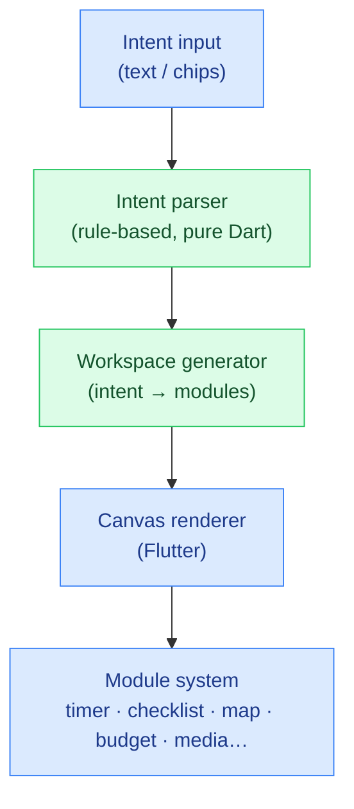

# IntentCanvas

**▶ Live demo: https://parag-labs.github.io/intent-canvas/** — a Flutter app running on the web
(it also runs natively on iOS/Android via `flutter run`). Everything is on-device; no backend,
no API keys.

An **intent-first mobile home**. Instead of a grid of app icons, the home screen is a living
**canvas**: you express a goal in plain language — *"plan my trip to Lisbon"*, *"help me focus"*
— and the interface generates a contextual workspace of cards, actions, and live data. It's
app-*less*: a spatial surface that assembles itself around what you're trying to do.

---

## Why

2026 is shifting from app-centric to intent-centric interfaces. Chat-only assistants exist, but
a **spatial, non-chat visual intent surface** that feels like a living workspace is rare and
highly demoable. IntentCanvas is that surface.

## Core idea

```
You state an intent  →  it's parsed into a category  →  a workspace of modules is generated
                        (deterministic, on-device)      (cards, checklists, stats, maps…)
```

The whole point is that the model of "what to show" is **deterministic and testable**: the same
intent always produces the same coherent workspace. The parser and generator are pure Dart with
no Flutter imports, so they're unit-tested and would run unchanged behind a real on-device LLM.

## Architecture



- **Intent parser** (`lib/core/intent.dart`) — whole-word keyword matching classifies free text
  into one of nine intents (focus, travel, health, finance, communication, learning, relax,
  shopping, or unknown). Always returns something usable.
- **Workspace generator** (`lib/core/generator.dart`) — maps an intent to an ordered set of
  typed `WorkspaceModule`s. Deterministic, so the canvas is reproducible.
- **Canvas + modules** (`lib/ui`, `lib/main.dart`) — a phone-framed Flutter surface that lays
  the modules out in a soft, spatial two-column canvas with hover/lift micro-interactions.

## Demo

Requires **Flutter 3.47.9** (stable, Dart 3.13) — the version CI and the Pages deploy use.

```bash
flutter pub get
flutter run -d chrome     # web
flutter run               # a connected device / simulator
```

Type an intent, or tap one of the suggestion chips, and watch the workspace assemble. Six
polished intents are wired up: focus, travel, health, finance, communication, and wind-down.

## Design decisions

- **Non-chat, spatial.** The result is a *workspace*, not a message thread — modules occupy
  space and can grow. This is the differentiator from chat assistants.
- **Deterministic core.** "Which modules for which intent" is rules, not a black box, so it's
  reproducible and testable. A real on-device model can slot in behind the same `Intent` type.
- **Calm, dark, glassy.** Soft surfaces, a violet/teal accent pair, and gentle depth so the
  canvas feels alive without being noisy.

## Testing

The pure-Dart core is covered by `flutter test` — 14 tests across intent parsing (classification
of every category, whole-word matching so "work" ≠ "workout", empty-safety, determinism) and
workspace generation (every intent yields ≥3 unique modules, six samples produce six distinct
workspaces).

```bash
flutter test
```

## Roadmap

- Voice input for stating intents.
- Draggable, resizable modules with persisted layout ("intent memory" across sessions).
- A small on-device model behind the `Intent` type for fuzzier phrasing.
- User-defined module types and intents.

## Layout

```
intent-canvas/
├── lib/
│   ├── core/               # pure Dart, unit-tested
│   │   ├── intent.dart     # Intent model + rule-based parser
│   │   └── generator.dart  # intent → workspace modules
│   ├── ui/
│   │   ├── theme.dart      # design tokens
│   │   └── module_card.dart# the module card widget
│   └── main.dart           # the intent canvas screen
├── test/                   # 14 flutter_test unit tests
└── web/
```

## License

MIT — see [LICENSE](LICENSE).
